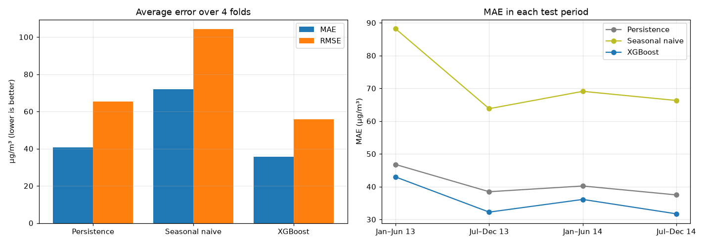
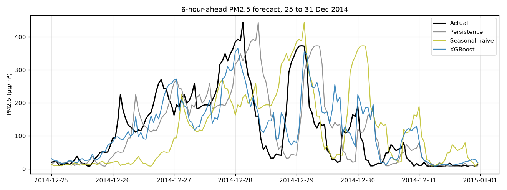
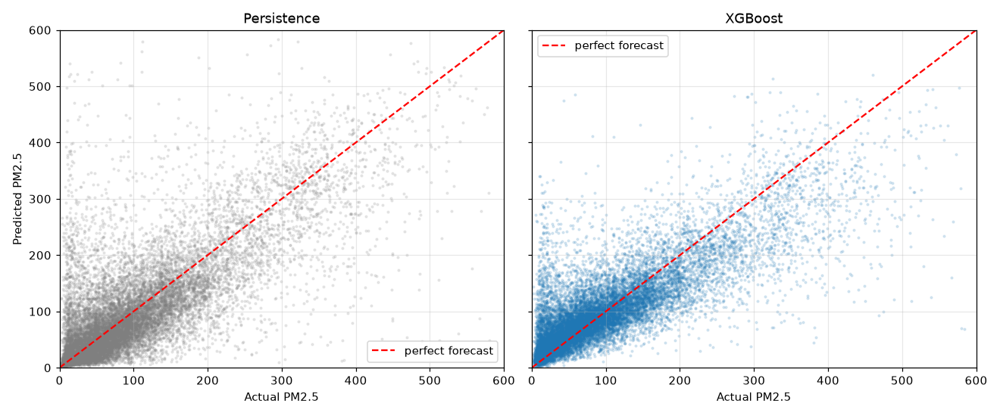
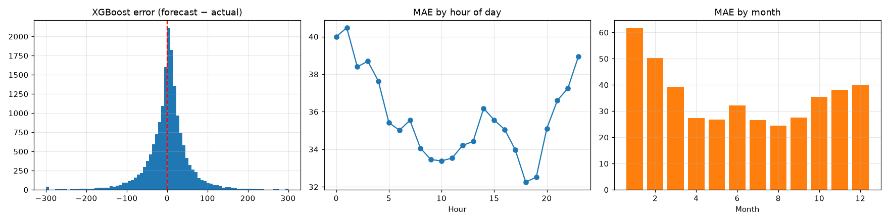
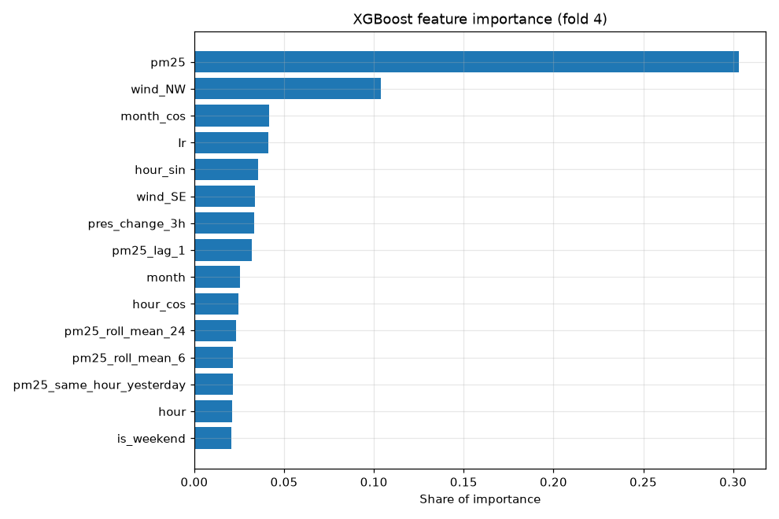

# Project 19: Air Quality Forecasting via Gradient Boosting

> **Course:** Semester 5 Applied Machine Learning (AML)
> **Dataset:** UCI Beijing PM2.5, 43,824 hourly records, 1 Jan 2010 to 31 Dec 2014
> **Target:** PM2.5 concentration (µg/m³) **6 hours ahead**
> **AQI standard:** US EPA PM2.5 breakpoints (2024 update)

---

## 1. Project Overview & Architecture

This project forecasts short-horizon PM2.5 in Beijing from past pollution and weather, and compares models fairly with a **rolling chronological backtest**.

- **Baselines:** persistence (PM2.5 in 6 hours = PM2.5 now) and seasonal naive (same hour yesterday).
- **AML model:** **XGBoost** regression on 31 engineered features: lags, rolling means, calendar and weather covariates.
- **Evaluation:** MAE, RMSE and R² on 4 expanding-window folds, plus AQI category accuracy.
- **Next phase:** a sequence model (LSTM) to test whether longer temporal patterns beat the hand-picked lag windows.

```
Raw CSV ─► data_loader.py ─► features.py ─► backtest.py (4 time-ordered folds)
                                                 │
                    ┌────────────────────────────┼────────────────────────────┐
              Persistence                 Seasonal naive                  XGBoost
                    └────────────────────────────┼────────────────────────────┘
                                                 ▼
                         Metrics · charts · AQI categories · dashboard
```

---

## 2. Results at a Glance

| Model | MAE (µg/m³) | RMSE (µg/m³) | R² | MAE vs persistence |
| --- | --- | --- | --- | --- |
| Persistence | 40.73 | 65.31 | 0.518 | — |
| Seasonal naive | 71.84 | 104.19 | -0.223 | 76% worse |
| **XGBoost** | **35.76** | **55.80** | **0.652** | **12% better** |

Average over 4 folds (Jan 2013 to Dec 2014), scored only on hours where PM2.5 was really measured.



---

## 3. Quickstart

```bash
# 1. Set up the environment
./scripts/setup_environment.sh
source venv/bin/activate          # Windows: venv\Scripts\activate

# 2. Run each step of the pipeline
python data_loader.py             # clean the raw data
python features.py                # build features + target
python baselines.py               # score the two baselines
python xgboost_model.py           # train and score XGBoost

# 3. Re-run every notebook (EDA → features → training → evaluation)
python scripts/run_notebooks.py

# 4. Run the automated tests
pytest tests/
```

See [docs/environment_setup.md](docs/environment_setup.md) for Windows and troubleshooting.

---

## 4. Dataset

| Column | Meaning | Unit |
| --- | --- | --- |
| `pm2.5` → `pm25` | PM2.5 concentration (**target**) | µg/m³ |
| `DEWP` | Dew point | °C |
| `TEMP` | Temperature | °C |
| `PRES` | Air pressure | hPa |
| `cbwd` | Combined wind direction (NE, NW, SE, cv = calm/variable) | text |
| `Iws` | Cumulated wind speed | m/s |
| `Is` | Cumulated hours of snow | hours |
| `Ir` | Cumulated hours of rain | hours |

Source: [UCI Machine Learning Repository, dataset 381](https://archive.ics.uci.edu/dataset/381/beijing). Only PM2.5 has missing values: 2,067 hours (4.7%).

---

## 5. Exploratory Data Analysis

Full write-up: [docs/EDA_REPORT.md](docs/EDA_REPORT.md)

| PM2.5 over time | Seasonality |
| --- | --- |
|  |  |
| **Wind direction** | **Autocorrelation** |
|  |  |

- PM2.5 is **right-skewed** (median 72, max 994 µg/m³) and very **persistent** (correlation 0.75 with 6 hours ago).
- Strong **daily** (night peak) and **yearly** (winter heating peak) cycles.
- **Northwest wind** clears the air (median 31), while **calm air** traps pollution (median 98).

---

## 6. Features & Backtest

Full specification: [docs/FEATURE_SPECIFICATION.md](docs/FEATURE_SPECIFICATION.md)

| Group | Features |
| --- | --- |
| Current PM2.5 | `pm25` |
| Lags | `pm25_lag_1`, `_2`, `_3`, `_6`, `_12`, `_24`, `pm25_same_hour_yesterday` |
| Rolling means | `pm25_roll_mean_6`, `pm25_roll_mean_24` |
| Calendar | `hour`, `day_of_week`, `month`, `is_weekend`, `hour_sin`, `hour_cos`, `month_sin`, `month_cos` |
| Weather | `DEWP`, `TEMP`, `PRES`, `Iws`, `Is`, `Ir`, `temp_dewp_gap`, `pres_change_3h` |
| Wind direction | `wind_NE`, `wind_NW`, `wind_SE`, `wind_cv` |
| Missing flag | `pm25_missing` |


Each fold trains on all earlier data and tests on the next 6 months. The last 6 training hours are never used as targets, so no future information leaks in.

---

## 7. Model Training & Evaluation

| Forecast vs actual | Predicted vs actual |
| --- | --- |
|  |  |
| **Error analysis** | **Feature importance** |
|  |  |

- **XGBoost wins in every fold**, with MAE 8% to 16% lower than persistence.
- Errors are largest in **January and February** (heating season) and during sudden pollution spikes.
- **Current PM2.5** carries about 30% of the importance, followed by calendar (20%), wind direction (16%) and weather (16%).

---

## 8. Notebooks Structure

```
notebooks/
├── 01.EDA/
│   ├── 01_data_understanding.ipynb          # Loading, columns, summary stats, missing values, target distribution
│   └── 02_patterns_and_target.ipynb         # Trend, seasonality, wind, correlations, autocorrelation
├── 02.FeatureEngineering/
│   └── 01_cleaning_and_features.ipynb       # Cleaning, 31 features, leakage check, backtest folds
├── 03.ModelTraining/
│   └── 01_baselines_and_xgboost.ipynb       # Baselines + XGBoost on every fold, saves predictions and model
└── 04.ModelEvaluation/
    ├── 01_model_comparison.ipynb            # MAE / RMSE / R², forecast plots, error analysis
    └── 02_feature_importance.ipynb          # XGBoost importance by feature and by group
```

Every notebook is saved with its outputs, so the charts and tables show directly on GitHub.

---

## 9. Repository Layout

```text
air-quality-forecasting/
├── README.md
├── requirements.txt
├── config.py                         # All settings: paths, horizon, lags, test periods
├── data_loader.py                    # Load + clean (regular hourly, missing flag, forward fill)
├── features.py                       # Lags, rolling means, calendar, weather, target
├── backtest.py                       # Rolling chronological folds + metrics
├── baselines.py                      # Persistence and seasonal naive
├── xgboost_model.py                  # XGBoost regression
├── data/
│   ├── PRSA_data_2010.1.1-2014.12.31.csv
│   └── GeneratedOutput/
│       ├── 01.EDA/                   # Summary, missing values, seasonality, correlations, autocorrelation
│       ├── 02.FeatureEngineering/    # Feature list, backtest folds
│       ├── 03.ModelTraining/         # Predictions, training log, saved XGBoost model
│       └── 04.ModelEvaluation/       # Model comparison, per-fold metrics, feature importance
├── notebooks/                        # 6 notebooks (see above)
├── reports/
│   └── figures/                      # 14 charts used in this README and the docs
├── docs/
│   ├── EDA_REPORT.md
│   ├── FEATURE_SPECIFICATION.md
│   └── environment_setup.md
├── scripts/
│   ├── setup_environment.sh          # Create venv + install packages
│   └── run_notebooks.py              # Run every notebook in order
└── tests/
    ├── conftest.py
    └── test_pipeline.py              # 10 checks: cleaning, no leakage, folds, metrics, model
```

Member 5 adds `aqi.py`, `plots.py`, `main.py` and `app.py` (AQI mapping, charts, one-command runner and Streamlit dashboard).

---

## 10. Team progress

| Member | Files | Status |
| --- | --- | --- |
| Member 1: Manan Gilhotra | requirements.txt, config.py, data_loader.py | Done |
| Member 2: Harshita | features.py | Done |
| Member 3: satyam-coder07 | backtest.py, baselines.py | Done |
| Member 4: Yashi Agarwal | xgboost_model.py | Done |
| Member 5 | aqi.py, plots.py, main.py, app.py | To do |

## Member 1: data cleaning

```bash
python data_loader.py
```

This creates `data/clean_data.csv`: one row per hour, a `pm25_missing` flag, gaps filled with the last known value, and wind direction one-hot encoded.

## Member 2: feature engineering

```bash
python features.py
```

This reads `data/clean_data.csv` and creates `data/features.csv`: lag features (1, 2, 3, 6, 12 and 24 hours), rolling means (6 and 24 hours), calendar features (hour, day of week, month, weekend, sin/cos), weather features (temperature–dew point gap, 3-hour pressure change) and the target, PM2.5 6 hours ahead.

## Member 3: rolling backtest and baselines

```bash
python baselines.py
```

backtest.py splits the data by time into 4 folds. Each fold trains on everything before its test period and tests on the next 6 months (Jan–Jun 2013, Jul–Dec 2013, Jan–Jun 2014, Jul–Dec 2014). It also scores forecasts with MAE, RMSE and R squared, only on hours where the real PM2.5 was measured. baselines.py scores two simple forecasts every model must beat: persistence (PM2.5 in 6 hours = PM2.5 now) and seasonal naive (PM2.5 at the same hour yesterday).

| Fold | Persistence MAE | Persistence RMSE | Persistence R² | Seasonal naive MAE | Seasonal naive RMSE | Seasonal naive R² |
| --- | --- | --- | --- | --- | --- | --- |
| 1 (Jan–Jun 2013) | 46.77 | 78.23 | 0.506 | 88.17 | 125.13 | -0.263 |
| 2 (Jul–Dec 2013) | 38.46 | 59.75 | 0.440 | 63.80 | 92.57 | -0.344 |
| 3 (Jan–Jun 2014) | 40.21 | 64.21 | 0.568 | 69.09 | 101.36 | -0.077 |
| 4 (Jul–Dec 2014) | 37.49 | 59.06 | 0.558 | 66.30 | 97.68 | -0.209 |

## Member 4: XGBoost model

```bash
python xgboost_model.py
```

XGBoost builds 300 small decision trees, each one correcting the errors of the trees before it. It uses all 31 features from features.py, trains only on hours where the future PM2.5 was really measured, and is tested on the same 4 folds as the baselines.

| Fold | XGBoost MAE | XGBoost RMSE | XGBoost R² | Persistence MAE | MAE improvement |
| --- | --- | --- | --- | --- | --- |
| 1 (Jan–Jun 2013) | 42.96 | 70.61 | 0.598 | 46.77 | 8% |
| 2 (Jul–Dec 2013) | 32.24 | 48.26 | 0.635 | 38.46 | 16% |
| 3 (Jan–Jun 2014) | 36.11 | 56.36 | 0.667 | 40.21 | 10% |
| 4 (Jul–Dec 2014) | 31.72 | 47.96 | 0.708 | 37.49 | 15% |
| Average | 35.76 | 55.80 | 0.652 | 40.73 | 12% |

XGBoost beats both baselines in every fold. The most important features in the last fold were current PM2.5, northwest wind, season (month_cos), rain hours and time of day.
