# Project 19: Air Quality Forecasting via Gradient Boosting and LSTM Models

> **Course:** Semester 5 Applied Machine Learning and Deep Learning (AML / DL)
> **Dataset:** UCI Beijing PM2.5, 43,824 hourly records, 1 Jan 2010 to 31 Dec 2014
> **Target:** PM2.5 concentration (µg/m³) **6 hours ahead**
> **AQI standard:** US EPA PM2.5 breakpoints (2024 update)

**Project report (IEEE format, Phase 1 + Phase 2):** [PDF](reports/IEEE_Project_Report.pdf)  
**Phase 2 presentation:** [PowerPoint, with speaker notes](reports/Phase2_Presentation.pptx) · [PDF](reports/Phase2_Presentation.pdf) · **Phase 1 presentation:** [PDF](reports/Air_Quality_Forecasting_Presentation.pdf)  
**Phase 2 write-up:** [docs/DEEP_LEARNING.md](docs/DEEP_LEARNING.md)

---

## 1. Project Overview & Architecture

This project forecasts short-horizon PM2.5 in Beijing from past pollution and weather, and compares models fairly with a **rolling chronological backtest**.

- **Baselines:** persistence (PM2.5 in 6 hours = PM2.5 now) and seasonal naive (same hour yesterday).
- **Phase 1, AML model:** **XGBoost** regression on 31 engineered features: lags, rolling means, calendar and weather covariates.
- **Phase 2, DL models:** an **LSTM** and a **temporal CNN** trained on raw 48-hour sequences, with no hand-made lags.
- **Hybrid:** the average of XGBoost, LSTM and temporal CNN forecasts.
- **Evaluation:** MAE, RMSE and R² on 4 expanding-window folds, plus AQI category accuracy (exact, and within one category).

```
Raw CSV ─► data_loader.py ─► features.py ─► backtest.py (4 time-ordered folds)
                                                 │
        ┌──────────────┬─────────────────────────┼──────────────────────────┐
   Persistence   Seasonal naive               XGBoost               sequences.py (48-hour windows)
                                       (hand-made lag features)        ┌────────┴────────┐
                                                 │                    LSTM         Temporal CNN
                                                 └──────────┬──────────┴─────────────────┘
                                                            ▼
                                                  Hybrid (average of the three)
                                                            ▼
                                   Metrics · charts · AQI categories · dashboard
```

---

## 2. Results at a Glance

| Model | MAE (µg/m³) | RMSE (µg/m³) | R² | AQI category accuracy | AQI within one category | MAE vs persistence |
| --- | --- | --- | --- | --- | --- | --- |
| Persistence | 40.73 | 65.31 | 0.518 | 49.8% | 86.8% | — |
| Seasonal naive | 71.84 | 104.19 | -0.223 | 31.5% | 65.8% | 76% worse |
| XGBoost | 35.76 | 55.80 | 0.652 | 53.9% | 90.2% | 12% better |
| LSTM | 34.28 | 54.38 | 0.667 | 55.1% | 90.2% | 16% better |
| Temporal CNN (TCN) | 34.17 | 54.82 | 0.662 | 55.7% | 90.4% | 16% better |
| **Hybrid** | **33.76** | **53.41** | **0.680** | **55.8%** | **90.6%** | **17% better** |

Average over 4 folds (Jan 2013 to Dec 2014), scored only on hours where PM2.5 was really measured. The **hybrid** has the lowest error in every fold: 17% below persistence and 5.6% below XGBoost.

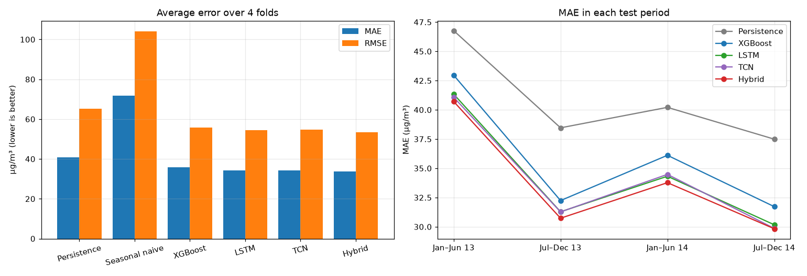

---

## 3. Quickstart

```bash
# 1. Set up the environment
./scripts/setup_environment.sh
source venv/bin/activate          # Windows: venv\Scripts\activate

# 2. Run each step of the pipeline
python data_loader.py             # clean the raw data
python features.py                # build features + target
python baselines.py               # score the two baselines
python xgboost_model.py           # train and score XGBoost

# 3. Phase 2: LSTM, temporal CNN and hybrid (about 15 to 30 minutes)
python main_dl.py

# 4. Re-run every notebook (EDA → features → training → evaluation → deep learning)
python scripts/run_notebooks.py

# 5. Run the automated tests
pytest tests/
```

See [docs/environment_setup.md](docs/environment_setup.md) for Windows and troubleshooting.

---

## 4. Dataset

| Column | Meaning | Unit |
| --- | --- | --- |
| `pm2.5` → `pm25` | PM2.5 concentration (**target**) | µg/m³ |
| `DEWP` | Dew point | °C |
| `TEMP` | Temperature | °C |
| `PRES` | Air pressure | hPa |
| `cbwd` | Combined wind direction (NE, NW, SE, cv = calm/variable) | text |
| `Iws` | Cumulated wind speed | m/s |
| `Is` | Cumulated hours of snow | hours |
| `Ir` | Cumulated hours of rain | hours |

Source: [UCI Machine Learning Repository, dataset 381](https://archive.ics.uci.edu/dataset/381/beijing). Only PM2.5 has missing values: 2,067 hours (4.7%).

---

## 5. Exploratory Data Analysis

Full write-up: [docs/EDA_REPORT.md](docs/EDA_REPORT.md)

| PM2.5 over time | Seasonality |
| --- | --- |
| 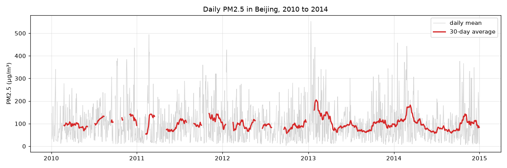 | 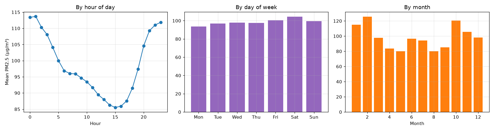 |
| **Wind direction** | **Autocorrelation** |
| 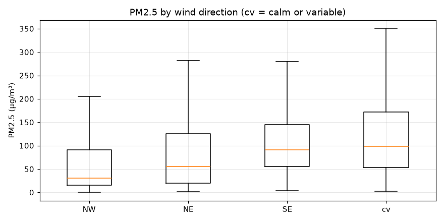 | 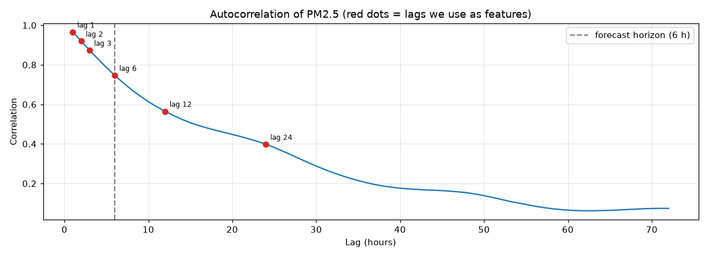 |

- PM2.5 is **right-skewed** (median 72, max 994 µg/m³) and very **persistent** (correlation 0.75 with 6 hours ago).
- Strong **daily** (night peak) and **yearly** (winter heating peak) cycles.
- **Northwest wind** clears the air (median 31), while **calm air** traps pollution (median 98).

---

## 6. Features & Backtest

Full specification: [docs/FEATURE_SPECIFICATION.md](docs/FEATURE_SPECIFICATION.md)

| Group | Features |
| --- | --- |
| Current PM2.5 | `pm25` |
| Lags | `pm25_lag_1`, `_2`, `_3`, `_6`, `_12`, `_24`, `pm25_same_hour_yesterday` |
| Rolling means | `pm25_roll_mean_6`, `pm25_roll_mean_24` |
| Calendar | `hour`, `day_of_week`, `month`, `is_weekend`, `hour_sin`, `hour_cos`, `month_sin`, `month_cos` |
| Weather | `DEWP`, `TEMP`, `PRES`, `Iws`, `Is`, `Ir`, `temp_dewp_gap`, `pres_change_3h` |
| Wind direction | `wind_NE`, `wind_NW`, `wind_SE`, `wind_cv` |
| Missing flag | `pm25_missing` |

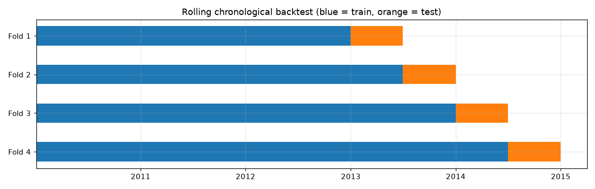

Each fold trains on all earlier data and tests on the next 6 months. The last 6 training hours are never used as targets, so no future information leaks in.

---

## 7. Model Training & Evaluation

| Forecast vs actual | Predicted vs actual |
| --- | --- |
| 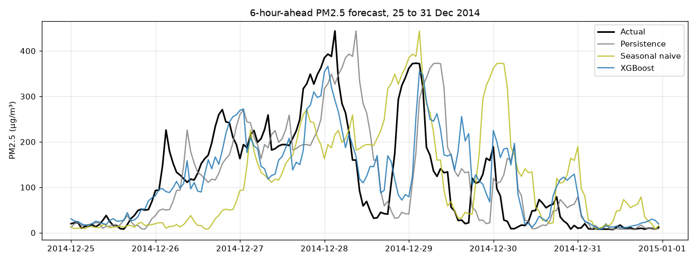 | 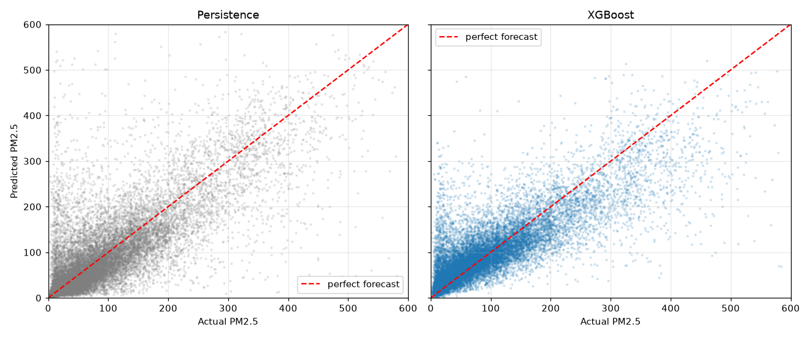 |
| **Error analysis** | **Feature importance** |
| 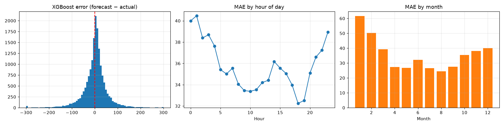 | 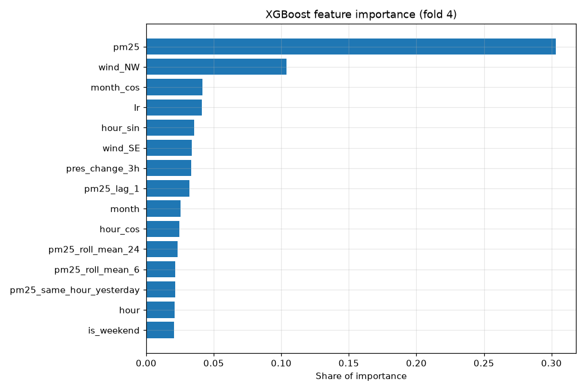 |

- **XGBoost wins in every fold**, with MAE 8% to 16% lower than persistence.
- Errors are largest in **January and February** (heating season) and during sudden pollution spikes.
- **Current PM2.5** carries about 30% of the importance, followed by calendar (20%), wind direction (16%) and weather (16%).

---

## 8. Phase 2: Deep Learning and Hybrid

Full write-up: [docs/DEEP_LEARNING.md](docs/DEEP_LEARNING.md)

**The gap from Phase 1:** XGBoost only sees the lag windows we picked by hand, and they carried only about 12% of its importance. The sequence models read the **raw last 48 hours** (16 features per hour) and learn the time patterns themselves.

| Step | What we do |
| --- | --- |
| Sequences | 48-hour windows of raw data; scaling fitted on training dates only; last 10% of each training period used for validation |
| Target | The networks predict the **change** in PM2.5 over the next 6 hours (persistence = "no change") |
| LSTM | 64 hidden units, reads the window hour by hour |
| Temporal CNN | 4 causal convolution layers with dilation 1, 2, 4, 8 |
| Training | L1 loss, Adam, early stopping on validation MAE, 3 seeds averaged |
| Hybrid | Simple average of XGBoost, LSTM and temporal CNN |

| One training example | Training with early stopping |
| --- | --- |
| 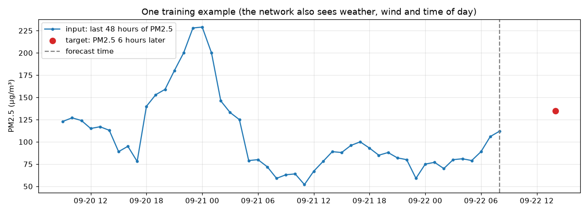 | 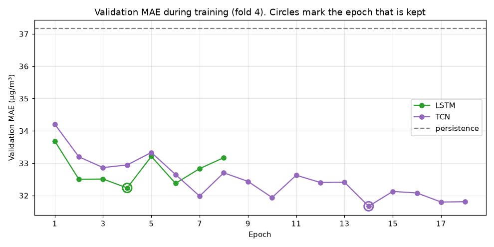 |
| **Hybrid forecast vs actual** | **Error by month** |
| 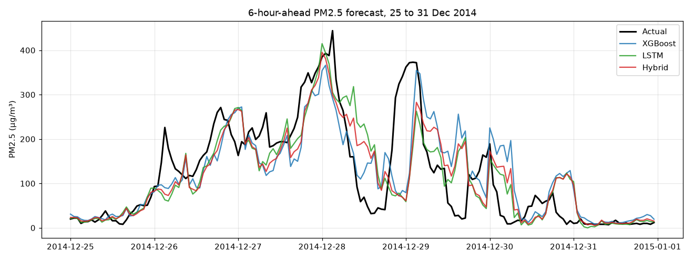 | 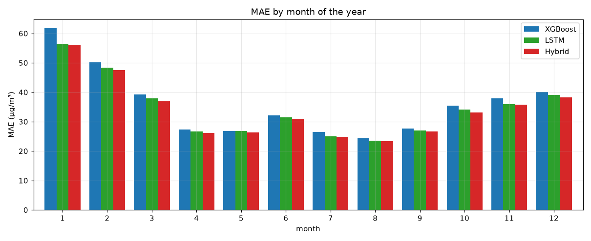 |

MAE in each test period:

| Fold | Persistence | XGBoost | LSTM | TCN | Hybrid |
| --- | --- | --- | --- | --- | --- |
| 1 (Jan–Jun 2013) | 46.77 | 42.96 | 41.34 | 41.07 | **40.71** |
| 2 (Jul–Dec 2013) | 38.46 | 32.24 | 31.28 | 31.27 | **30.73** |
| 3 (Jan–Jun 2014) | 40.21 | 36.11 | 34.32 | 34.48 | **33.77** |
| 4 (Jul–Dec 2014) | 37.49 | 31.72 | 30.17 | 29.86 | **29.83** |
| Average | 40.73 | 35.76 | 34.28 | 34.17 | **33.76** |

- Both sequence models beat XGBoost on average **without any hand-made lag features**.
- The **hybrid wins in all 4 folds** and is the best model on MAE, RMSE, R² and both AQI accuracies (55.8% exact category, 90.6% within one category).

### What we tried to improve accuracy

Notebook: `notebooks/05.DeepLearning/04_improvement_experiments.ipynb`. Network experiments: `dl_experiments.py` (networks in `dl_experiment_models.py`). Every experiment uses the same 4 folds and the same measured hours.

**1. The improvement journey.** Each step changes one thing:

| Step | MAE | RMSE | R² |
| --- | --- | --- | --- |
| 1. LSTM predicts the PM2.5 level (MSE loss) | 36.74 | 56.19 | 0.645 |
| 2. Predict the 6-hour CHANGE instead | 36.11 | 55.62 | 0.652 |
| 3. L1 loss (the metric we report) | 34.99 | 55.91 | 0.648 |
| 4. Average of 3 training runs (seeds) | 34.28 | 54.38 | 0.667 |
| 5. Hybrid: XGBoost + LSTM + TCN | 33.76 | 53.41 | 0.680 |

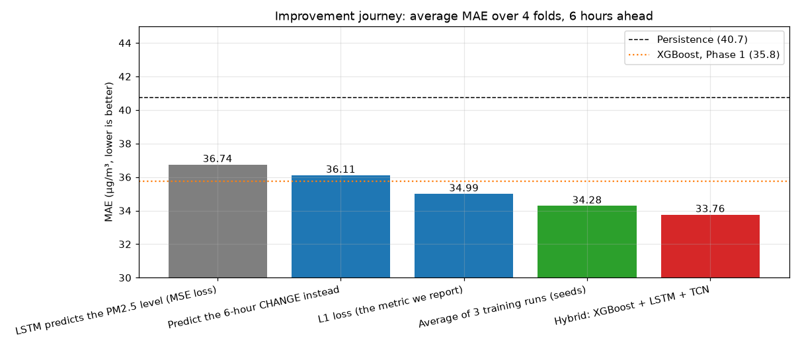

**2. Seven network designs** with the same data and training set-up. They all land within 0.98 µg/m³ of each other, so a more complex network does not help; we keep the LSTM and the TCN.

| Network (one training run each) | MAE | RMSE | R² |
| --- | --- | --- | --- |
| TCN | 34.47 | 54.99 | 0.660 |
| GRU | 34.55 | 54.82 | 0.661 |
| Attention LSTM | 34.59 | 54.85 | 0.663 |
| LSTM | 34.99 | 55.91 | 0.648 |
| Bi-LSTM | 35.08 | 55.84 | 0.649 |
| CNN-LSTM | 35.16 | 55.78 | 0.651 |
| Transformer | 35.45 | 55.80 | 0.649 |

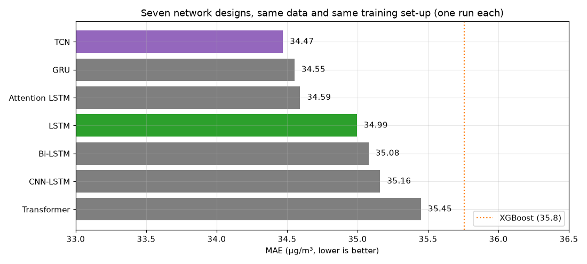

**3. Other ideas.** ARIMA is about as good as persistence. Training XGBoost on the change improves XGBoost, but the hybrid only a little (its errors become more like the networks' errors), so the Phase 1 XGBoost stays in the hybrid. Learned stacking weights do not beat the equal-weight average. The perfect-weather run uses the actual weather 6 hours later and is **not a valid forecast**: it only shows how much a weather forecast could add.

| Idea | MAE | RMSE | R² |
| --- | --- | --- | --- |
| ARIMA(3,1,0) | 40.65 | 65.16 | 0.520 |
| ARIMA(12,1,0) | 40.89 | 63.96 | 0.538 |
| ARIMA(24,1,0) | 41.20 | 63.32 | 0.548 |
| XGBoost (change, L1) | 34.41 | 54.61 | 0.665 |
| Hybrid with XGBoost (change, L1) | 33.60 | 53.61 | 0.677 |
| Stacked hybrid | 33.94 | 53.55 | 0.678 |
| XGBoost (weather up to now) | 35.76 | 55.80 | 0.652 |
| XGBoost + perfect weather forecast (what-if only) | 29.72 | 46.34 | 0.760 |

**4. Other honest views of accuracy (hybrid, 6 hours ahead).** AQI category exactly right: 55.8%. Right category or the one next to it: 90.6%. Correct yes/no alert for PM2.5 above 35.4: 85.5% (persistence 82.1%). Accuracy also depends strongly on the horizon:

| Hours ahead | Persistence R² | XGBoost R² | XGBoost AQI within one |
| --- | --- | --- | --- |
| 1 | 0.940 | 0.940 | 99.0% |
| 2 | 0.857 | 0.874 | 97.3% |
| 3 | 0.771 | 0.809 | 95.4% |
| 6 | 0.518 | 0.652 | 90.2% |

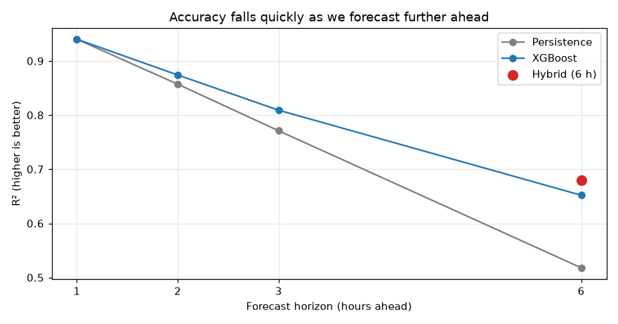

---

## 9. Notebooks Structure

```
notebooks/
├── 01.EDA/
│   ├── 01_data_understanding.ipynb          # Loading, columns, summary stats, missing values, target distribution
│   └── 02_patterns_and_target.ipynb         # Trend, seasonality, wind, correlations, autocorrelation
├── 02.FeatureEngineering/
│   └── 01_cleaning_and_features.ipynb       # Cleaning, 31 features, leakage check, backtest folds
├── 03.ModelTraining/
│   └── 01_baselines_and_xgboost.ipynb       # Baselines + XGBoost on every fold, saves predictions and model
├── 04.ModelEvaluation/
│   ├── 01_model_comparison.ipynb            # MAE / RMSE / R², forecast plots, error analysis
│   └── 02_feature_importance.ipynb          # XGBoost importance by feature and by group
└── 05.DeepLearning/
    ├── 01_sequences_and_networks.ipynb      # Validation split, scaling, 48-hour windows, LSTM and TCN, one training run
    ├── 02_dl_backtest.ipynb                 # LSTM and TCN on every fold (3 seeds each), saves forecasts
    ├── 03_hybrid_and_comparison.ipynb       # Hybrid ensemble, all six models compared, error analysis
    └── 04_improvement_experiments.ipynb     # What we tried: journey, 7 network designs, ARIMA, stacking, what-if
```

Every notebook is saved with its outputs, so the charts and tables show directly on GitHub.

---

## 10. Repository Layout

```text
air-quality-forecasting/
├── README.md
├── requirements.txt
├── config.py                         # All settings: paths, horizon, lags, test periods
├── data_loader.py                    # Load + clean (regular hourly, missing flag, forward fill)
├── features.py                       # Lags, rolling means, calendar, weather, target
├── backtest.py                       # Rolling chronological folds + metrics
├── baselines.py                      # Persistence and seasonal naive
├── xgboost_model.py                  # XGBoost regression
├── aqi.py                            # PM2.5 → US EPA AQI category
├── plots.py                          # Result charts (errors, forecast, AQI view)
├── main.py                           # Runs the whole pipeline with one command
├── app.py                            # Streamlit dashboard (reads saved results)
├── dl_data.py                        # Phase 2: validation split + scaling fitted on training dates
├── sequences.py                      # Phase 2: 48-hour windows and the change target
├── lstm_model.py                     # Phase 2: LSTM network
├── tcn_model.py                      # Phase 2: temporal CNN network
├── dl_training.py                    # Phase 2: training loop, early stopping, DL backtest
├── hybrid.py                         # Phase 2: average of XGBoost, LSTM and TCN
├── plots_dl.py                       # Phase 2: charts for all six models
├── main_dl.py                        # Phase 2: runs everything with one command
├── dl_experiments.py                 # Phase 2: improvement experiments (one training run each)
├── dl_experiment_models.py           # Phase 2: GRU, Bi-LSTM, CNN-LSTM, Attention LSTM, Transformer
├── images/                           # 3 result charts shown in the Member 5 section
├── results/                          # Created by main.py and main_dl.py (not tracked in git)
├── data/
│   ├── PRSA_data_2010.1.1-2014.12.31.csv
│   └── GeneratedOutput/
│       ├── 01.EDA/                   # Summary, missing values, seasonality, correlations, autocorrelation
│       ├── 02.FeatureEngineering/    # Feature list, backtest folds
│       ├── 03.ModelTraining/         # Predictions, training log, saved XGBoost model
│       ├── 04.ModelEvaluation/       # Model comparison, per-fold metrics, feature importance
│       └── 05.DeepLearning/          # LSTM/TCN forecasts, training history, six-model comparison
├── notebooks/                        # 10 notebooks (see above)
├── reports/
│   ├── IEEE_Project_Report.pdf       # Project report in IEEE format (Phase 1 + Phase 2)
│   ├── Phase2_Presentation.pptx      # Phase 2 presentation with speaker notes (also .pdf)
│   ├── Air_Quality_Forecasting_Presentation.pdf   # Phase 1 presentation
│   └── figures/                      # 22 charts used in this README and the docs
├── docs/
│   ├── EDA_REPORT.md
│   ├── FEATURE_SPECIFICATION.md
│   ├── DEEP_LEARNING.md              # Phase 2 write-up
│   └── environment_setup.md
├── scripts/
│   ├── setup_environment.sh          # Create venv + install packages
│   └── run_notebooks.py              # Run every notebook in order
└── tests/
    ├── conftest.py
    ├── test_pipeline.py              # 10 checks: cleaning, no leakage, folds, metrics, model
    └── test_deep_learning.py         # 13 checks: validation split, scaling, windows, networks, hybrid, AQI
```

---

## 11. Team progress

**Phase 1 (AML)**

| Member | Files | Status |
| --- | --- | --- |
| Member 1: Manan Gilhotra | requirements.txt, config.py, data_loader.py | Done |
| Member 2: Harshita | features.py | Done |
| Member 3: Satyam | backtest.py, baselines.py | Done |
| Member 4: Yashi Agarwal | xgboost_model.py | Done |
| Member 5: Akhil Mishra | aqi.py, plots.py, main.py, app.py | Done |

**Phase 2 (Deep Learning)**

| Member | Role | Files | Status |
| --- | --- | --- | --- |
| Manan Gilhotra | DL setup, validation split and scaling; improvement experiments, notebooks, tests and docs | requirements.txt, config.py, dl_data.py, dl_experiments.py, dl_experiment_models.py, notebooks/05.DeepLearning, tests/test_deep_learning.py, docs/DEEP_LEARNING.md | Done |
| Harshita | Sequence features: 48-hour windows and the change target | sequences.py | Done |
| Yashi Agarwal | The networks: LSTM and temporal CNN | lstm_model.py, tcn_model.py | Done |
| Satyam | Training loop, early stopping and DL backtest | dl_training.py | Done |
| Akhil Mishra | Hybrid ensemble, Phase 2 runner, charts, AQI accuracy and dashboard | aqi.py, hybrid.py, plots_dl.py, main_dl.py, app.py | Done |

## Member 1: data cleaning

```bash
python data_loader.py
```

This creates `data/clean_data.csv`: one row per hour, a `pm25_missing` flag, gaps filled with the last known value, and wind direction one-hot encoded.

## Member 2: feature engineering

```bash
python features.py
```

This reads `data/clean_data.csv` and creates `data/features.csv`: lag features (1, 2, 3, 6, 12 and 24 hours), rolling means (6 and 24 hours), calendar features (hour, day of week, month, weekend, sin/cos), weather features (temperature–dew point gap, 3-hour pressure change) and the target, PM2.5 6 hours ahead.

## Member 3: rolling backtest and baselines

```bash
python baselines.py
```

backtest.py splits the data by time into 4 folds. Each fold trains on everything before its test period and tests on the next 6 months (Jan–Jun 2013, Jul–Dec 2013, Jan–Jun 2014, Jul–Dec 2014). It also scores forecasts with MAE, RMSE and R squared, only on hours where the real PM2.5 was measured. baselines.py scores two simple forecasts every model must beat: persistence (PM2.5 in 6 hours = PM2.5 now) and seasonal naive (PM2.5 at the same hour yesterday).

| Fold | Persistence MAE | Persistence RMSE | Persistence R² | Seasonal naive MAE | Seasonal naive RMSE | Seasonal naive R² |
| --- | --- | --- | --- | --- | --- | --- |
| 1 (Jan–Jun 2013) | 46.77 | 78.23 | 0.506 | 88.17 | 125.13 | -0.263 |
| 2 (Jul–Dec 2013) | 38.46 | 59.75 | 0.440 | 63.80 | 92.57 | -0.344 |
| 3 (Jan–Jun 2014) | 40.21 | 64.21 | 0.568 | 69.09 | 101.36 | -0.077 |
| 4 (Jul–Dec 2014) | 37.49 | 59.06 | 0.558 | 66.30 | 97.68 | -0.209 |

## Member 4: XGBoost model

```bash
python xgboost_model.py
```

XGBoost builds 300 small decision trees, each one correcting the errors of the trees before it. It uses all 31 features from features.py, trains only on hours where the future PM2.5 was really measured, and is tested on the same 4 folds as the baselines.

| Fold | XGBoost MAE | XGBoost RMSE | XGBoost R² | Persistence MAE | MAE improvement |
| --- | --- | --- | --- | --- | --- |
| 1 (Jan–Jun 2013) | 42.96 | 70.61 | 0.598 | 46.77 | 8% |
| 2 (Jul–Dec 2013) | 32.24 | 48.26 | 0.635 | 38.46 | 16% |
| 3 (Jan–Jun 2014) | 36.11 | 56.36 | 0.667 | 40.21 | 10% |
| 4 (Jul–Dec 2014) | 31.72 | 47.96 | 0.708 | 37.49 | 15% |
| Average | 35.76 | 55.80 | 0.652 | 40.73 | 12% |

XGBoost beats both baselines in every fold. The most important features in the last fold were current PM2.5, northwest wind, season (month_cos), rain hours and time of day.

## Member 5: AQI mapping, results and dashboard

Run the whole project with one command:

```bash
python main.py
```

Then open the optional dashboard:

```bash
streamlit run app.py
```

aqi.py maps PM2.5 (µg/m³) to US EPA AQI categories (2024 breakpoints: Good ≤ 9.0, Moderate ≤ 35.4, Unhealthy for Sensitive Groups ≤ 55.4, Unhealthy ≤ 125.4, Very Unhealthy ≤ 225.4, Hazardous above). EPA defines these on 24-hour averages; we apply them to each hourly forecast as a simple label. plots.py draws the charts, main.py runs every step and saves the results, and app.py is a Streamlit dashboard that reads the saved results.

### Final results (6-hour-ahead PM2.5, average over 4 folds)

| Model | MAE (µg/m³) | RMSE (µg/m³) | R² | AQI category accuracy |
| --- | --- | --- | --- | --- |
| Persistence | 40.73 | 65.31 | 0.518 | 49.8% |
| Seasonal naive | 71.84 | 104.19 | -0.223 | 31.5% |
| XGBoost | 35.76 | 55.80 | 0.652 | 53.9% |

XGBoost has the lowest error in every fold and puts the forecast in the right AQI category most often.

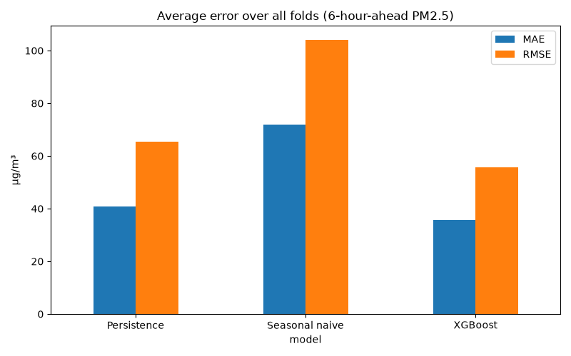

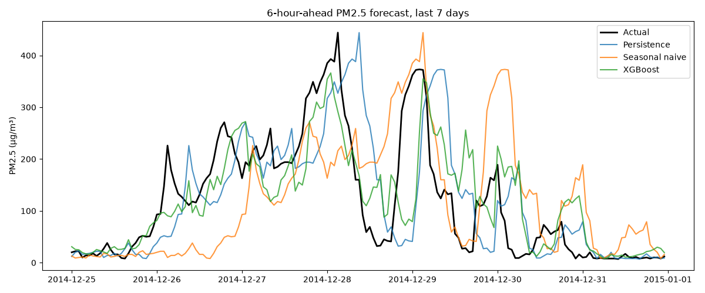

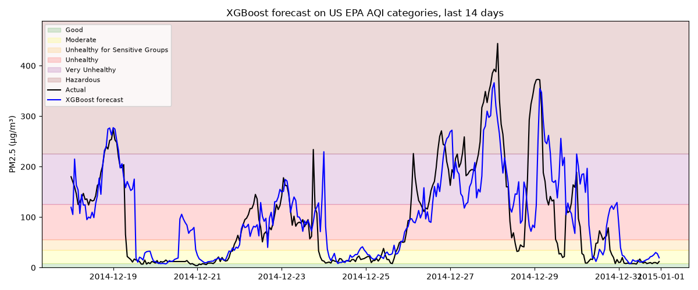

