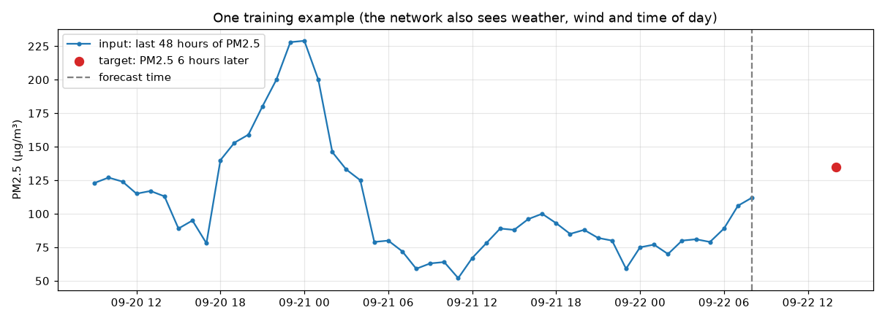
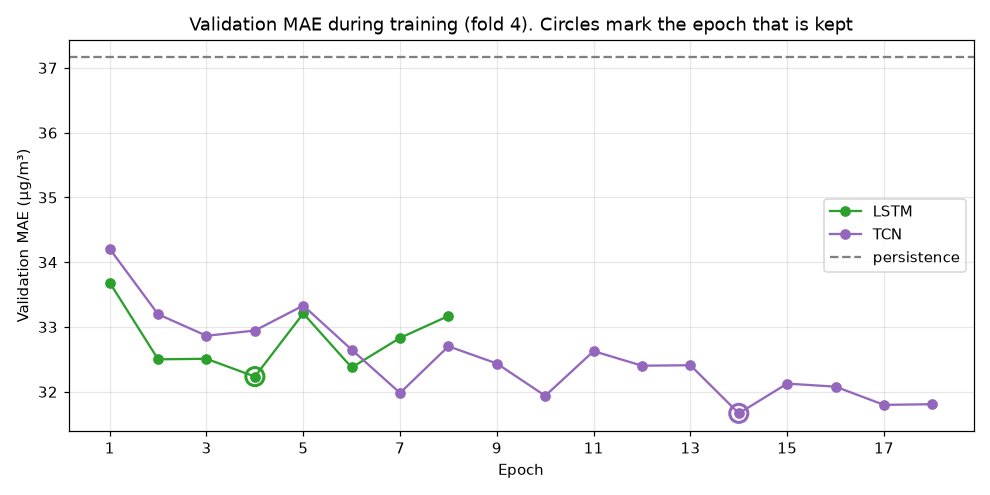
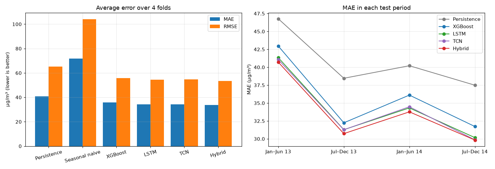
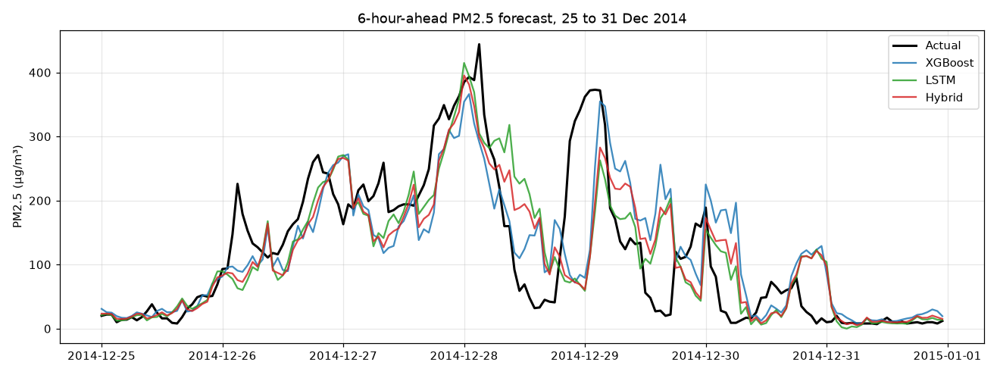
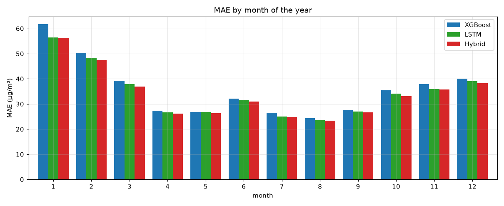

# Phase 2: Deep Learning and the Hybrid Ensemble

**Code:** `dl_data.py`, `sequences.py`, `lstm_model.py`, `tcn_model.py`, `dl_training.py`, `hybrid.py`, `main_dl.py`, `plots_dl.py`
**Notebooks:** `notebooks/05.DeepLearning/` (3 notebooks)
**Tables:** `data/GeneratedOutput/05.DeepLearning/`
**Figures:** `reports/figures/15_*.png` to `19_*.png`

---

## 1. Why Phase 2

Phase 1 showed that XGBoost beats persistence by 12%, but it only sees the lag windows we chose by hand (1, 2, 3, 6, 12 and 24 hours), and those lags carried only about 12% of its feature importance. Phase 2 tests the gap named in the project brief: *manually chosen windows may not represent longer temporal dependencies or non-linear pollutant–weather interactions*.

We train two sequence models on fixed 48-hour windows of raw data, an **LSTM** and a **temporal CNN (TCN)**, produce a point forecast with each, and only then combine them with XGBoost in a **hybrid ensemble**. Everything is evaluated with the same rolling chronological backtest as Phase 1.

## 2. Sequence data (`dl_data.py`, `sequences.py`)



| Item | Choice |
| --- | --- |
| Input window | The last **48 hours** (`SEQ_LEN = 48`) |
| Features per hour (16) | `pm25`, `pm25_missing`, `DEWP`, `TEMP`, `PRES`, `Iws`, `Is`, `Ir`, `hour_sin`, `hour_cos`, `month_sin`, `month_cos`, `wind_NE`, `wind_NW`, `wind_SE`, `wind_cv` |
| Learning target | The **change** in PM2.5 over the next 6 hours, divided by its training standard deviation |
| Forecast | Current PM2.5 + predicted change, clipped at 0 |
| Validation | The last 10% of each training period, by time |
| Scaling | Mean and standard deviation fitted on the **training rows only** |

- **No hand-made lags:** the window already contains every past hour.
- **Why predict the change?** Persistence is the special case "change = 0", so the network starts from the strongest baseline and only learns the correction.
- **No leakage:** windows end at the forecast hour; validation is later than the rows the network learns from; the last 6 rows before each boundary are not used as targets; windows whose future PM2.5 was not measured are skipped.

## 3. The networks (`lstm_model.py`, `tcn_model.py`)

| Model | How it reads the 48 hours | Size |
| --- | --- | --- |
| **LSTM** | Hour by hour, keeping a memory (64 hidden units); a linear layer turns the final memory into the forecast | 21,057 parameters |
| **Temporal CNN** | 4 causal convolution layers (32 filters, kernel 3, dilation 1, 2, 4, 8, dropout 0.1); the last layer sees 31 hours | 10,913 parameters |

## 4. Training (`dl_training.py`)



| Setting | Value |
| --- | --- |
| Loss | L1 (mean absolute error) |
| Optimiser | Adam, learning rate 0.001, batch size 256, gradient clipping at 1.0 |
| Early stopping | Validation MAE checked after every epoch; stop after 4 epochs without improvement; best weights restored |
| Maximum epochs | 30 |
| Seeds | Each network is trained **3 times** per fold and the 3 forecasts are averaged |

In the example run on fold 4, the LSTM's best validation MAE is 32.23 µg/m³ and the TCN's is 31.67 µg/m³. Both are below persistence from the first epoch.

## 5. Hybrid ensemble (`hybrid.py`)

The hybrid is the **simple average** of the XGBoost, LSTM and TCN forecasts. XGBoost learns from hand-made lag features and the networks from raw sequences, so their errors are only partly correlated, and averaging cancels part of them. The weights are equal, so nothing is tuned on test data.

## 6. Results

Average over the 4 test periods (Jan 2013 to Dec 2014), scored only on hours where PM2.5 was really measured:

| Model | MAE (µg/m³) | RMSE (µg/m³) | R² | AQI category accuracy | AQI within one category | MAE vs persistence |
| --- | --- | --- | --- | --- | --- | --- |
| Persistence | 40.73 | 65.31 | 0.518 | 49.8% | 86.8% | — |
| Seasonal naive | 71.84 | 104.19 | -0.223 | 31.5% | 65.8% | 76% worse |
| XGBoost | 35.76 | 55.80 | 0.652 | 53.9% | 90.2% | 12% better |
| LSTM | 34.28 | 54.38 | 0.667 | 55.1% | 90.2% | 16% better |
| Temporal CNN (TCN) | 34.17 | 54.82 | 0.662 | 55.7% | 90.4% | 16% better |
| **Hybrid** | **33.76** | **53.41** | **0.680** | **55.8%** | **90.6%** | **17% better** |



MAE in each test period:

| Fold | Persistence | XGBoost | LSTM | TCN | Hybrid |
| --- | --- | --- | --- | --- | --- |
| 1 (Jan–Jun 2013) | 46.77 | 42.96 | 41.34 | 41.07 | **40.71** |
| 2 (Jul–Dec 2013) | 38.46 | 32.24 | 31.28 | 31.27 | **30.73** |
| 3 (Jan–Jun 2014) | 40.21 | 36.11 | 34.32 | 34.48 | **33.77** |
| 4 (Jul–Dec 2014) | 37.49 | 31.72 | 30.17 | 29.86 | **29.83** |
| Average | 40.73 | 35.76 | 34.28 | 34.17 | **33.76** |

- **Both sequence models beat XGBoost** on average MAE without any hand-made lag features (LSTM in 4 of 4 folds, TCN in 4 of 4), which confirms the gap identified in Phase 1.
- **The hybrid is the best model on every metric** and has the lowest MAE in all 4 folds. Its MAE is 17% lower than persistence and 5.6% lower than XGBoost.
- **AQI categories:** the hybrid assigns the correct US EPA category for 55.8% of hours, against 53.9% for XGBoost. Counting a forecast as correct when it is in the right category or the one next to it, the hybrid reaches **90.6%** (XGBoost 90.2%, persistence 86.8%). Exact category accuracy stays near 56% because some categories are only about 20 µg/m³ wide, so a close forecast on the wrong side of a boundary counts as a miss.





## 7. Limitations

- The gain over XGBoost is real but moderate: PM2.5 six hours ahead is limited by sudden episodes that have no early sign in the last 48 hours of one station.
- The networks use observed weather only. Weather forecasts for the next 6 hours and data from nearby stations would likely help more than a larger network.
- Hyperparameters (window length, network size, learning rate) were chosen with the validation periods, not with an exhaustive search.
- Results can differ in the first or second decimal on another computer, because of floating-point differences in training.

## 8. How to run

```bash
python main_dl.py        # Phase 1 models + LSTM + TCN + hybrid, about 15 to 30 minutes
streamlit run app.py     # dashboard with all six models
pytest tests/            # 22 automatic checks
```
