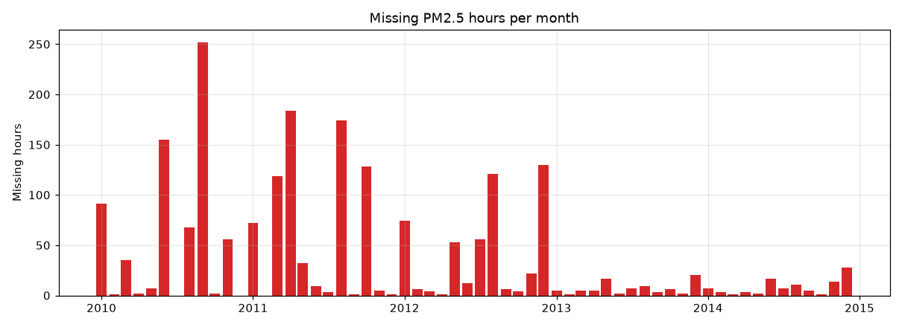
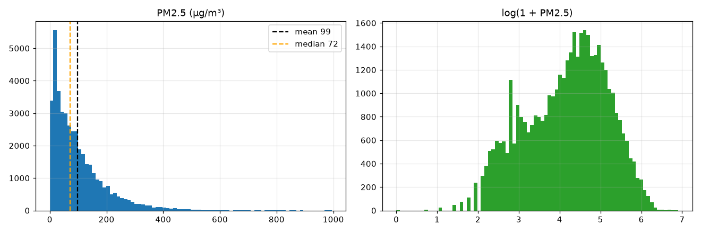
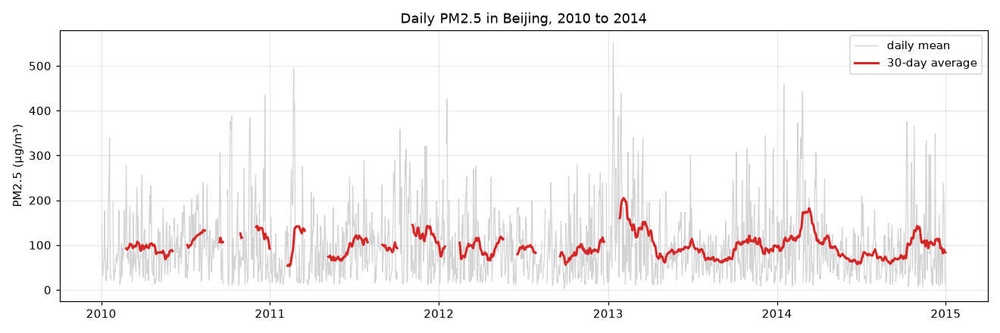
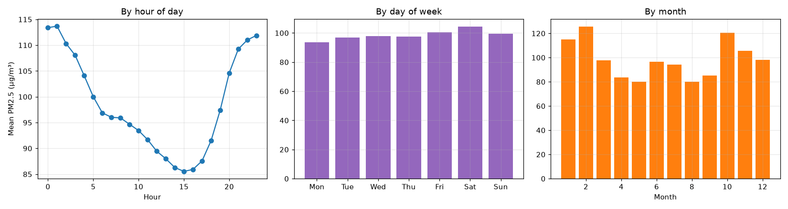
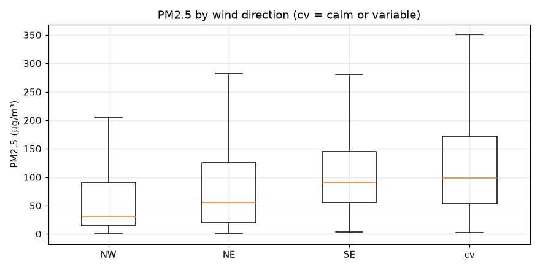
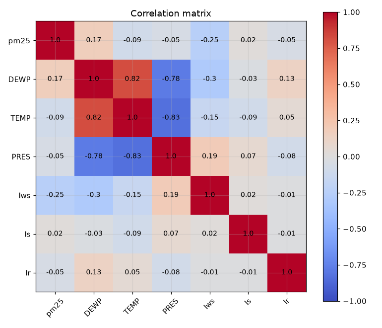
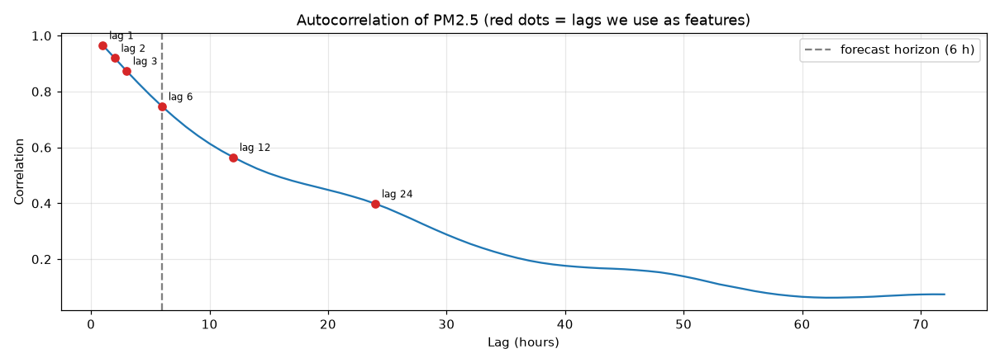

# Exploratory Data Analysis Report

**Dataset:** UCI Beijing PM2.5 (US Embassy monitor), hourly, 1 Jan 2010 to 31 Dec 2014
**Notebooks:** `notebooks/01.EDA/01_data_understanding.ipynb`, `notebooks/01.EDA/02_patterns_and_target.ipynb`
**Tables:** `data/GeneratedOutput/01.EDA/`
**Figures:** `reports/figures/01_*.png` to `07_*.png`

---

## 1. Dataset at a glance

| Item | Value |
| --- | --- |
| Rows | 43,824 hourly records |
| Period | 2010-01-01 00:00 to 2014-12-31 23:00 |
| Columns used | `pm25`, `DEWP`, `TEMP`, `PRES`, `cbwd`, `Iws`, `Is`, `Ir` |
| Target | PM2.5 (µg/m³), forecast 6 hours ahead |
| Missing values | Only PM2.5: 2,067 hours (4.7%) |

## 2. Missing values

| Year | Missing PM2.5 hours |
| --- | --- |
| 2010 | 669 |
| 2011 | 728 |
| 2012 | 489 |
| 2013 | 82 |
| 2014 | 99 |

- The longest gap is **155 hours** in a row. The first day of 2010 is fully missing and is dropped during cleaning.
- **Decision:** keep a `pm25_missing` flag and fill gaps with forward fill only (no future values). Hours whose real value was missing are never used for training targets or scoring.

## 3. Target distribution

| Statistic | PM2.5 (µg/m³) |
| --- | --- |
| Mean | 98.6 |
| Median | 72 |
| 25th / 75th percentile | 29 / 137 |
| Maximum | 994 |
| Skewness | 1.8 |

- Strongly right-skewed: a few severe episodes push RMSE well above MAE, so we report both.
- Around 9% of hours are above 225.4 µg/m³ (Hazardous under the US EPA scale).

## 4. Trend and seasonality

- **No long-term trend:** yearly means range from 90.5 (2012) to 104.0 (2010).
- **Daily cycle:** highest around midnight (about 113) and lowest mid-afternoon (about 86 at 15:00).
- **Yearly cycle:** highest in the heating season (February about 126, October about 120) and lowest in late spring and summer (about 80).
- **Day of week:** small effect (94 to 104).
- **Decision:** add `hour`, `month`, day of week, a weekend flag and sin/cos encodings of hour and month.

## 5. Wind and weather

| Wind direction | Mean PM2.5 | Median PM2.5 | Hours |
| --- | --- | --- | --- |
| NW (northwest) | 70.1 | 31 | 13,484 |
| NE (northeast) | 90.2 | 55 | 4,756 |
| SE (southeast) | 110.8 | 91 | 14,573 |
| cv (calm / variable) | 126.2 | 98 | 8,944 |

- Northwest wind brings clean air from the mountains, while calm air lets pollution build up.
- Linear correlations with PM2.5 are weak: wind speed `Iws` -0.25, dew point `DEWP` 0.17, the others under 0.1 in size. The effects are non-linear and interact, which suits a tree model.
- **Decision:** one-hot encode wind direction, and add the temperature–dew point gap (humidity) and the 3-hour pressure change.

## 6. Autocorrelation

| Lag (hours) | 1 | 2 | 3 | 6 | 12 | 24 | 48 | 72 |
| --- | --- | --- | --- | --- | --- | --- | --- | --- |
| Correlation | 0.965 | 0.920 | 0.874 | 0.747 | 0.565 | 0.398 | 0.153 | 0.074 |

- PM2.5 is very persistent at short lags, so **persistence** is a strong baseline.
- Memory fades after about 2 days. **Decision:** lags of 1, 2, 3, 6, 12 and 24 hours, plus 6 h and 24 h rolling means.

## 7. Summary of decisions

| Finding | Decision |
| --- | --- |
| 4.7% of PM2.5 missing, in long gaps | Missing flag, forward fill only, score only on measured hours |
| Skewed target with extreme episodes | Report MAE and RMSE together |
| Strong short-term autocorrelation | Lag and rolling features, persistence baseline |
| Daily and yearly cycles | Calendar features with sin/cos |
| Wind direction strongly linked to PM2.5 | One-hot wind columns |
| Time-ordered data | Rolling chronological backtest, never shuffle |
