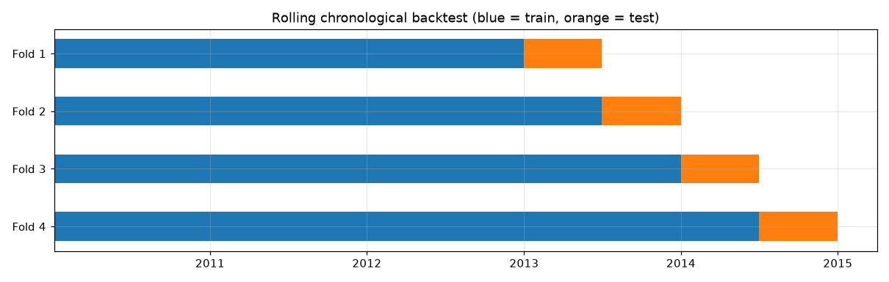

# Feature and Backtest Specification

**Code:** `data_loader.py`, `features.py`, `backtest.py`
**Notebook:** `notebooks/02.FeatureEngineering/01_cleaning_and_features.ipynb`
**Tables:** `data/GeneratedOutput/02.FeatureEngineering/`

---

## 1. Cleaning (`data_loader.py`)

1. Build one `datetime` index from year, month, day and hour, and sort by time.
2. Put the series on a regular hourly clock (`asfreq("h")`).
3. Add `pm25_missing` (1 = PM2.5 was not measured) **before** filling.
4. Forward fill PM2.5, weather and wind direction (past values only).
5. Drop the first rows that have no earlier value (1 Jan 2010).
6. One-hot encode wind direction into `wind_NE`, `wind_NW`, `wind_SE`, `wind_cv`.

Result: **43,800 hourly rows**, 12 columns, no empty values, 2,043 hours flagged.

## 2. Target

| Column | Definition |
| --- | --- |
| `target` | PM2.5 exactly **6 hours after** the forecast time (`shift(-6)`) |
| `target_observed` | 1 if that future PM2.5 was really measured, 0 if it was filled |

Models are trained and scored only where `target_observed == 1`.

## 3. Features (31)

| Group | Features |
| --- | --- |
| Current PM2.5 | `pm25` |
| Lag | `pm25_lag_1`, `pm25_lag_2`, `pm25_lag_3`, `pm25_lag_6`, `pm25_lag_12`, `pm25_lag_24`, `pm25_same_hour_yesterday` |
| Rolling mean | `pm25_roll_mean_6`, `pm25_roll_mean_24` |
| Calendar | `hour`, `day_of_week`, `month`, `is_weekend`, `hour_sin`, `hour_cos`, `month_sin`, `month_cos` |
| Weather | `DEWP`, `TEMP`, `PRES`, `Iws`, `Is`, `Ir`, `temp_dewp_gap`, `pres_change_3h` |
| Wind direction | `wind_NE`, `wind_NW`, `wind_SE`, `wind_cv` |
| Missing flag | `pm25_missing` |

`pm25_same_hour_yesterday` is PM2.5 at the same clock hour one day before the target hour (`shift(18)`). It is also the seasonal naive forecast.

All features use only the current and past hours. The notebook checks that `target` equals PM2.5 6 hours later and that `pm25_lag_6` equals PM2.5 6 hours earlier.

## 4. Rolling chronological backtest (`backtest.py`)

| Fold | Train period | Train rows | Test period | Test rows |
| --- | --- | --- | --- | --- |
| 1 | Jan 2010 – Dec 2012 | 24,388 | Jan – Jun 2013 | 4,309 |
| 2 | Jan 2010 – Jun 2013 | 28,697 | Jul – Dec 2013 | 4,369 |
| 3 | Jan 2010 – Dec 2013 | 33,066 | Jan – Jun 2014 | 4,311 |
| 4 | Jan 2010 – Jun 2014 | 37,377 | Jul – Dec 2014 | 4,344 |

Rows counted are those with a measured target.

- The training window **expands**: each fold trains on all data before its test period.
- **Leakage guard:** the last 6 training hours have targets inside the test period, so they are kept as history but not used as training targets.
- **Metrics:** MAE, RMSE and R² on each fold, then averaged.
