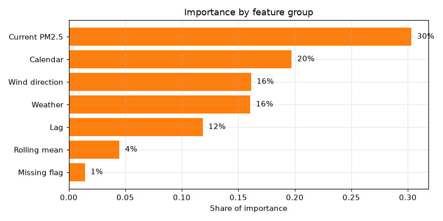

# Air Quality Forecasting via Gradient Boosting

**Course:** Semester 5 Applied Machine Learning · **Project 19** · October 2026  
**Team:** Manan Gilhotra, Harshita, Satyam, Yashi Agarwal, Akhil Mishra  
**Code:** [github.com/MananGilhotra/air-quality-forecasting](https://github.com/MananGilhotra/air-quality-forecasting)

## Abstract

We forecast PM2.5 concentration in Beijing **6 hours ahead** from past pollution and weather readings. Using the UCI Beijing PM2.5 dataset (43,824 hourly records, 2010–2014), we engineer 31 features and train an **XGBoost** regressor. We compare it with persistence and seasonal naive baselines in a 4-fold **rolling chronological backtest**. XGBoost achieves an average MAE of **35.8 µg/m³**, against 40.7 for persistence (**12% lower error**), and raises R² from 0.52 to 0.65. It wins in every test period. Forecasts are also mapped to US EPA AQI categories, where XGBoost assigns the correct category 53.9% of the time.

## 1. Introduction and Objective

Fine particulate matter (PM2.5) is one of the most harmful air pollutants. It reaches deep into the lungs and is linked to heart and lung disease. A reliable short-term forecast lets people and city agencies act before pollution peaks, for example by limiting outdoor activity or issuing health warnings.

**Objective:** forecast hourly PM2.5 at a fixed horizon, and test whether a machine learning model beats simple forecasting rules under a fair, time-respecting evaluation.

| Design choice | Our decision |
| --- | --- |
| Forecast horizon | 6 hours ahead (fixed) |
| Target | PM2.5 concentration in µg/m³ |
| Main model | XGBoost gradient-boosted trees |
| Baselines | Persistence, seasonal naive (24 h) |
| Evaluation | Rolling chronological backtest, MAE, RMSE, R² |
| AQI standard | US EPA PM2.5 breakpoints (2024 update) |

**The gap we address:** hand-made lag windows may miss longer time patterns and non-linear interactions between pollution and weather. A gradient-boosted tree model captures non-linear interactions, and a sequence model (LSTM) is planned as the next step for longer patterns.

## 2. Dataset and Exploratory Analysis

We use the [UCI Beijing PM2.5 dataset](https://archive.ics.uci.edu/dataset/381/beijing): hourly readings from the US Embassy in Beijing, 1 Jan 2010 to 31 Dec 2014.

| Column | Meaning | Unit |
| --- | --- | --- |
| pm2.5 | PM2.5 concentration (target) | µg/m³ |
| DEWP, TEMP, PRES | Dew point, temperature, air pressure | °C, °C, hPa |
| cbwd | Wind direction (NE, NW, SE, calm/variable) | category |
| Iws, Is, Ir | Cumulated wind speed, hours of snow, hours of rain | m/s, h, h |

**Size and quality.** The file has 43,824 hourly rows. Only PM2.5 has missing values: 2,067 hours (4.7%), mostly in 2010–2012, with the longest gap lasting 155 hours.

**Key findings from EDA**

- **Skewed target.** The median PM2.5 is 72 µg/m³, the mean is 98.6 and the maximum is 994. Rare severe episodes make RMSE much larger than MAE, so we report both.
- **Strong persistence.** PM2.5 correlates 0.97 with the value 1 hour earlier, 0.75 with 6 hours earlier and 0.40 with 24 hours earlier. This makes "same as now" a strong baseline and motivates lag features.
- **Daily and yearly cycles.** Pollution peaks around midnight (about 113) and dips mid-afternoon (about 86). It is highest in the winter heating months (February about 126) and lowest in late spring and summer (about 80).
- **Wind matters most among weather variables.** Northwest wind brings clean mountain air (median 31 µg/m³), while calm air traps pollution (median 98). Linear correlations with weather are weak (wind speed −0.25), which suggests non-linear effects that suit tree models.

| Wind direction | Median PM2.5 (µg/m³) | Hours |
| --- | --- | --- |
| NW (northwest) | 31 | 13,484 |
| NE (northeast) | 55 | 4,756 |
| SE (southeast) | 91 | 14,573 |
| Calm / variable | 98 | 8,944 |

## 3. Methodology

### 3.1 Cleaning

We sort by time and resample to a regular hourly interval. Before filling any gaps, we add a `pm25_missing` flag, then forward fill using past values only, so no future information leaks into the inputs. The fully missing first day is dropped. Wind direction is one-hot encoded. The result is 43,800 clean hourly rows, with 2,043 hours flagged as missing.

### 3.2 Features and target

The **target** is PM2.5 exactly 6 hours after the forecast time. Rows whose future value was originally missing are never used for training or scoring. We build **31 features**, all from current and past hours only:

| Group | Features |
| --- | --- |
| Current PM2.5 | PM2.5 now |
| Lags | PM2.5 1, 2, 3, 6, 12 and 24 hours ago, and at the same hour yesterday |
| Rolling means | Average PM2.5 over the last 6 and 24 hours |
| Calendar | Hour, day of week, month, weekend flag, sin/cos of hour and month |
| Weather | Dew point, temperature, pressure, wind speed, snow, rain, temperature–dew point gap, 3-hour pressure change |
| Wind direction | 4 one-hot columns (NE, NW, SE, calm) |
| Missing flag | Whether PM2.5 was measured this hour |

### 3.3 Models

- **Persistence:** forecast = PM2.5 now.
- **Seasonal naive:** forecast = PM2.5 at the same clock hour one day earlier.
- **XGBoost:** 300 gradient-boosted trees (learning rate 0.05, max depth 6, 80% row and column sampling). Each new tree corrects the errors of the trees before it, which captures non-linear pollution–weather interactions. Tree models do not need feature scaling.

### 3.4 Rolling chronological backtest

Time series must never be shuffled, so we test on the future only. Each fold trains on **all data before** its test period and tests on the **next 6 months**:

| Fold | Training data | Test period | Test hours |
| --- | --- | --- | --- |
| 1 | Jan 2010 – Dec 2012 | Jan – Jun 2013 | 4,309 |
| 2 | Jan 2010 – Jun 2013 | Jul – Dec 2013 | 4,369 |
| 3 | Jan 2010 – Dec 2013 | Jan – Jun 2014 | 4,311 |
| 4 | Jan 2010 – Jun 2014 | Jul – Dec 2014 | 4,344 |

As a **leakage guard**, the last 6 training hours (whose targets fall inside the test period) are kept as history but not used as targets. All models are scored on the same hours with **MAE** (average error size), **RMSE** (penalises large misses) and **R²** (share of variance explained), and the 4 folds are averaged.

## 4. Results

**XGBoost is the best model in every fold.** Averaged over the 4 test periods (Jan 2013 to Dec 2014):

| Model | MAE (µg/m³) | RMSE (µg/m³) | R² | AQI category accuracy |
| --- | --- | --- | --- | --- |
| Persistence | 40.73 | 65.31 | 0.518 | 49.8% |
| Seasonal naive | 71.84 | 104.19 | −0.223 | 31.5% |
| **XGBoost** | **35.76** | **55.80** | **0.652** | **53.9%** |

- XGBoost lowers MAE by **12% on average** compared with persistence, and by 8% to 16% in individual folds.
- **Seasonal naive** performs worst, with a negative R² (worse than predicting the average). Yesterday's level is a poor guide 6 hours ahead, because pollution episodes build and clear within a day or two.
- **Error pattern:** XGBoost's errors are largest in January and February (MAE about 62 and 50), during the heating season and sudden spikes. They are smallest in summer (about 24 to 27).
- **AQI categories:** we map each forecast to the US EPA 2024 categories (Good ≤ 9.0, Moderate ≤ 35.4, Unhealthy for Sensitive Groups ≤ 55.4, Unhealthy ≤ 125.4, Very Unhealthy ≤ 225.4, Hazardous above). XGBoost picks the correct category for 53.9% of hours, compared with 49.8% for persistence. EPA defines these breakpoints on 24-hour averages, so applying them to hourly forecasts is a simplification.

**What the model relies on.** In the final fold, current PM2.5 carries about 30% of XGBoost's feature importance, calendar features 20%, wind direction and weather about 16% each, and the hand-picked lags only 12%. The single most useful weather signal is northwest wind.

All 14 project figures (EDA, backtest, forecasts, errors, importance) are in the repository under `reports/figures/`.

## 5. Discussion, Limitations and Future Work

**Why XGBoost wins.** Persistence already captures most of the short-term signal, because PM2.5 changes slowly. XGBoost adds value by learning *when* pollution is likely to rise or fall: at night, in winter, under calm air or before a northwest wind clears it. A simple rule cannot capture these combined effects.

**Limitations**

- **Sudden spikes are hard to predict.** Some extreme episodes (above 400 µg/m³) start within a few hours, and there are no early signs of them in 6 hours of history.
- **Fixed, hand-picked windows.** Lags only reach 24 hours, and the model gives them limited weight. Longer patterns, such as the build-up over several stagnant days, are only partly captured.
- **Single station and period.** The results apply to one Beijing monitor from 2010 to 2014. Emissions and regulations have changed since then.
- **Simplified AQI.** We apply 24-hour EPA breakpoints to hourly values.
- **No weather forecasts.** We only use observed weather. In practice, forecast wind and rain for the next 6 hours would likely help a lot.

**Future work**

1. Train an **LSTM** sequence model on the last 48 hours of raw data to test whether learned temporal patterns beat hand-picked lags.
2. Add **weather forecast** inputs and pollution data from nearby stations.
3. Tune hyperparameters with a time-ordered validation split, and evaluate several horizons (1, 6, 12 and 24 hours).
4. Forecast 24-hour averages directly for a fully standard AQI.

## 6. Conclusion

Under a fair rolling chronological backtest, an XGBoost model with lag, rolling, calendar and weather features forecasts 6-hour-ahead PM2.5 in Beijing **12% more accurately than persistence** (MAE 35.8 vs 40.7 µg/m³). It beats both baselines in every test period. The pipeline is reproducible from one public repository: 6 notebooks, 14 figures and 10 automated tests regenerate every number in this report.

### Team contributions

| Member | Responsibility | Files |
| --- | --- | --- |
| Manan Gilhotra | Project setup, data loading and cleaning | config.py, data_loader.py |
| Harshita | Feature engineering and target | features.py |
| Satyam | Rolling backtest, metrics and baselines | backtest.py, baselines.py |
| Yashi Agarwal | XGBoost model | xgboost_model.py |
| Akhil Mishra | AQI mapping, charts, pipeline runner, dashboard | aqi.py, plots.py, main.py, app.py |

### References

1. Chen, S. (2015). *Beijing PM2.5 Data*. UCI Machine Learning Repository. [archive.ics.uci.edu/dataset/381/beijing](https://archive.ics.uci.edu/dataset/381/beijing)
2. Hyndman, R. J. and Athanasopoulos, G. (2021). *Forecasting: Principles and Practice*, 3rd ed. OTexts.
3. Chen, T. and Guestrin, C. (2016). XGBoost: A Scalable Tree Boosting System. *Proceedings of KDD 2016*.
4. Hochreiter, S. and Schmidhuber, J. (1997). Long Short-Term Memory. *Neural Computation*, 9(8).
5. US EPA (2024). *Final Updates to the Air Quality Index for Particulate Matter*.
